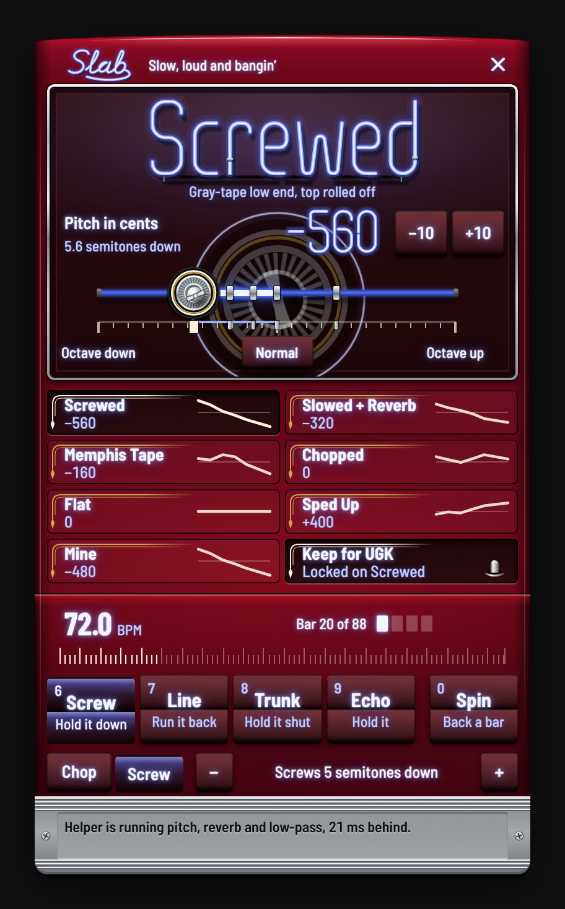

# SLAB

**Third Coast playback moods for Spicetify.**

SLAB is a playback deck for the Houston lineage — the sound DJ Screw built with two turntables, a pause button, and a trunk full of bass. It gives you the tonal fingerprints of that lineage, plus a row of pads that cut on the bar.

Named for **Slow, Loud And Bangin'**. No samples, no lean imagery, no costume. Just the mix moves.



---

## What it actually does

Spotify does not hand over the audio stream to extensions. There is no Web Audio node to insert, no buffer to stretch, and the player refuses `playbackSpeed` for music with `not_supported_by_content_type`. Any extension claiming real time-stretch inside the page on the current desktop client is either lying or shipping a broken button.

SLAB does the things the client can actually do, and pairs with a small companion app for the rest:

- **Six EQ moods** written against the client's native six-band equalizer.
- **A real pitch slider** — ±1200 cents, live, with the mood cards acting as presets that move it.
- **Real pitch shift, reverb, delay and low-pass** through [SLAB DSP](#slab-dsp-macos) — a menu-bar helper that taps Spotify's output at the OS level on macOS 14.2+. No page sandbox involved.
- **Beat-true chop pads** that jump back exactly 1, 2 or 4 bars to the same place in the bar, so the groove carries straight through, using Spotify's own audio analysis for the grid. They fire on the way down, like hardware, and with SLAB DSP running they land the instant you hit them: no waiting on Spotify to seek.
- **The Screw bank** — the other half of the name, on keys 6 to 0: hold Screw and the pitch rides down like a hand on the pitch fader, Line runs the lyric line you just heard back on the beat, Trunk shuts the lid on the sound, Echo throws it back in time with the song, and Spin backspins the record into a chop. The holds last as long as the pad is down.
- **Your own mood, kept for the artist** — a seventh door, Mine, keeps the sound you have on, and Keep locks a mood to whoever is playing, so UGK always comes on Screwed.
- **Tape stop** — a real pitch-and-speed spin-down when SLAB DSP is running, a fader pull into pause when it is not.
- **Auto chop** — cuts on the phrase lines every N bars and shows how far off the next cut is, on a worker clock that survives a backgrounded window.
- **The trunk lights up** — while the mood can be heard, the nameplate, the sign and every word on the paint burn as neon; paused, they go back to glass and whitewall. Behind the slider, a big 84 wire wheel turns once a bar, read off the beat grid, and its neon ring kicks on every beat.
- **An honest readout** — the sign and the playbar chip are only lit while the mood can actually be heard, the sill says what the helper and Spotify are doing right now, and when Spotify plays on another device the paint goes to grey primer and the panel names that device.

Tempo is the one thing SLAB does not change. See [why](#tempo-is-locked-on-purpose).

The slider's position is saved. A relaunch restores the mood and the slider where you left it, so a mood you nudged off its landing point stays nudged. Picking a mood moves the slider to that mood's cents.

### The moods

| Mood | What it is |
|---|---|
| **Slowed + Reverb** | The shape a record takes when it's dragged: low-mids swell, presence drops, the top turns to air. |
| **Screwed** | Screw's tonal signature — sub and low-mid forward, everything above 2k pulled back, like a gray tape played in a trunk. |
| **Chopped** | Dry and forward, presence up. The cut has to land, so the top stays alive. |
| **Memphis Tape** | 400–1k pushed until it honks, highs cut, bottom loose. Cassette dub. |
| **Sped Up** | The other direction: thin low end, bright presence and air. |
| **Flat** | Restores the curve your equalizer had when SLAB first loaded. |

These are EQ curves, not presets with names slapped on. The sparkline on each card is the actual curve.

**Mine** is the seventh door. Tap it while it's empty and it keeps the sound you have on: that mood's curve and room, at the pitch the slider has now. Tap it again any time to bring it back, and hold it to keep a new sound over the old one (Shift+Enter from the keyboard).

**Keep** is the eighth: it locks the mood you have on to the artist playing, and their tracks come on it from then on, quietly when SLAB starts and with a word on the sill when a track changes. While it's locked, whatever you pick for them is what's kept. Press it again to let them go. It's kept on this computer only.

### The pads

Two banks, the two halves of the name. The switch under the pads shows one at a time; the keys play both, and the panel shows whichever bank you last played.

**Chop** (keys `1`–`5`)

| Pad | Move |
|---|---|
| **Chop, 1 bar back** | Jump back exactly one bar, to the same place in it, the way two copies of a record a bar apart do under a crossfader. Every beat still lands where it should. |
| **Chop, 2 bars back** | The same, two bars. |
| **Chop, 4 bars back** | The same, four bars. |
| **Loop, 4 times** | Repeat the current bar four more times, cutting on the bar line, then let the record run. The pad stays lit and counts down; press it again to end the loop early. |
| **Stop, tape stop** | Fade, pause, restore the fader. One at a time, so a double tap can't leave the volume down. |

**Screw** (keys `6`–`0`)

| Pad | Move |
|---|---|
| **Screw, hold it down** | Hold it and the pitch rides down, slow, like a hand on the pitch fader on the hook; let go and it springs back to the mood. How far it rides is the stepper beside the switch, a semitone to an octave. |
| **Line, run it back** | Back to the start of the lyric line you just heard, at the same place in the beat, the way Screw ran a vocal back. Uses Spotify's synced lyrics; a track without them, or a stretch with no singing, gets a bar chop instead. |
| **Trunk, hold it shut** | The sound of a slab going by with the trunk shut: muffled and boomy while you hold it, and the lid pops open the moment you let go. |
| **Echo, hold it** | Throws the record back on the beat while you hold it, timed off the song's own tempo; let go and it rings off. |
| **Spin, back a bar** | Backspins the record for a beat and lands a bar back, on the beat, as if the record had kept turning under the spin. |

Screw, Trunk and Echo need SLAB DSP and say so without it. Spin without it is a plain bar chop.

Keyboard `1`–`0` plays the pads while the panel is open. A held key on Chop is one hit, a held key on Screw, Trunk or Echo holds it, and digits typed into Spotify's search or any text field never reach them. If the window loses the keys mid-hold, everything lets go. `Esc` closes the panel from inside it. A pad that can't do anything (no beat grid, or not that much record behind the needle yet) says why instead of doing nothing.

Auto chop cuts on the phrase lines this music is built on: with every 4 bars, at the top of bars 5, 9, 13 and so on, replaying the bar that ended the phrase. Only bars reached for the first time count, so the replayed bar, your own chops and a running loop can never set it off again. The stepper shows how many bars until the next cut.

---

## SLAB DSP (macOS)

The companion app is what makes the moods real. It taps Spotify's audio with `AudioHardwareCreateProcessTap`, runs it through an `AVAudioEngine` chain — pitch, low-pass, reverb, delay — and plays the result back. Spotify's own output is muted while it is attached, so what you hear is the processed copy.

| Control | Range |
|---|---|
| Pitch | ±2400 cents (two octaves), in cents |
| Reverb | 0–100 wet, with room/hall/plate/chamber characters |
| Delay | 10 ms–2 s, feedback 0–95, wet 0–100 |
| Low-pass | 200 Hz–20 kHz |
| Tape stop | Real rate ramp: 380 ms down, 70 ms hold, 240 ms back up |
| Chops and loops | Instant, from the last 45 seconds it has heard |
| Backspin | The record run backwards out of memory, landing on a chop |
| Holds | Screw, Trunk and Echo ramped on top of the mood, and back off it |

**Requirements:** macOS 14.2 or newer. Apple Silicon or Intel. Spotify desktop.

### Instant chops

Without the helper, a pad is a Spotify seek, and Spotify takes a moment to start playing again from the new spot. You can feel it under your fingers. The helper keeps the last 45 seconds of what Spotify played, so a pad jumps there inside the helper on the next block of audio, a few milliseconds, to the sample. Loops are sent ahead with the time they should land, and they land on the bar line exactly.

Spotify is still seeked, just out of earshot. SLAB sends it a little past the spot, the helper plays from memory until Spotify's audio comes back, finds the same sound in it and crosses over where the two meet. Nobody hears the restart. The helper measures what each seek cost and SLAB aims the next one by it. The helper only jumps through song it knows played straight through: never across a new track, a pause, or you dragging the record. Past that, a pad falls back to a plain seek.

Older helpers (before 0.4.0) don't have this, and the pads seek Spotify the old way. Rebuild with `bun run dsp:install` to get it.

### Install

```bash
bun run dsp:install
```

That builds `SLAB DSP.app`, copies it to `~/Applications`, and launches it. It lives in the menu bar as a small waveform: the menu shows what it is doing right now, and has **Reconnect to Spotify**, **Start at Login**, **Open Log** and **Quit**. The icon is dimmed whenever no audio is coming through. On first run macOS asks for **Audio Recording** permission — that is the process tap. Nothing is recorded, stored, or sent anywhere; the app has no network client beyond a loopback control port.

If the permission prompt was dismissed, re-enable it in **System Settings → Privacy & Security → Screen & System Audio Recording** (macOS 15) or **Audio Recording** (macOS 14), then relaunch the app.

Quit Spotify, reopen it, and the helper picks it up on its own with the same settings. It can be started before Spotify and will wait. A rebuilt copy is a new binary as far as macOS is concerned, so a build from source asks for the permission again.

The helper must be launched as an app (LaunchServices), not from a shell. TCC attributes the audio-capture grant to the responsible process, so a binary started from Terminal inherits Terminal's identity and taps silence.

### Linking

The helper listens on `http://127.0.0.1:47832`:

| Route | Purpose |
|---|---|
| `GET /status` | version, link state (`tapping`, `audio`), sample rate, level, latency, current params |
| `POST /params` | `{"pitch": -320, "reverb": 34, "lowpass": 11000}` |
| `POST /tapstop` | `{"downMs": 380, "holdMs": 70, "upMs": 240}` |
| `POST /jump` | `{"backMs": 3333, "inMs": 0, "seekAheadMs": 250, "availableMs": 12000}`: jump back in memory (forward when negative), `inMs` from now; `409` when that much song isn't there |
| `POST /jump/cancel` | call a jump off: one still to come never happens, one waiting on Spotify goes back to live (a new track, a pause) |
| `POST /spin` | `{"backMs": 1250, "spinMs": 417, "seekAheadMs": 250, "availableMs": 12000}`: spin back for `spinMs`, land `backMs` before where the spin began |
| `POST /hold` | `{"pitchOffset": -500, "lowpassCap": 420, "gainBoost": 3, "echoMix": 38, "echoFeedback": 48, "echoTime": 0.42, "ms": 650}`: what's held on top of the mood, ramped over `ms`; what it leaves out is let go, `{}` lets go of everything. Refresh it within 10 s or it lets go by itself |
| `POST /reset` | back to neutral |
| `POST /reconnect` | drop the tap and attach again |
| `POST /quit` | shut the helper down |

The panel probes `/status` every few seconds. The sill's status line says which it found: not running (SLAB is EQ-only), waiting for Spotify, attached with no audio yet, or live along with what it is actually running. Until audio is flowing the pitch tube sits unlit and the panel says "Set to", because nothing is being shifted yet. Moods push their DSP parameters on selection, so picking **Screwed** sets pitch, reverb and low-pass in one move. The pitch slider then moves from that point, and the helper is told to keep the rest of the mood intact.

The control port only answers to Spotify. Requests carrying an `Origin` other than `https://xpui.app.spotify.com` or `https://open.spotify.com` get `403` and never reach the audio graph, so a page you happen to have open cannot repitch your music or shut the helper down. The `Access-Control-Allow-Private-Network` grant is only sent back to those origins, on request. Requests with no `Origin` at all — `curl`, native clients — are still allowed, as long as their `Host` is loopback, which is what stops DNS rebinding from turning a page into a same-origin caller.

The extension degrades cleanly: no helper, no errors, no dead buttons. And it says when it can't be heard: the EQ and the tap only reach audio on this computer, so while Spotify Connect is playing on a console or a speaker the dead sign reads *Playing on XBOX. SLAB only reaches this computer.*

### Dev flags

```bash
./dsp/.build/release/SLABDSP --help
./dsp/.build/release/SLABDSP --set pitch=-560,reverb=16 --seconds 10
./dsp/.build/release/SLABDSP --record out.wav --seconds 6 --set pitch=-1200
```

`--record` writes the processed chain to a WAV and exits — that is how the pitch shift was verified (spectral centroid 2992 Hz → 1400 Hz at −1200 cents on the same passage).

---

## Tempo is locked on purpose

Slowed-and-reverbed records are slower. SLAB's pitch shift is not a tempo change, and this is deliberate:

- The player refuses `playbackSpeed` for music (`not_supported_by_content_type`), so there is no native slow-down to hook.
- A live tap cannot be slowed without unbounded drift. Spotify renders at 1×, so a ring buffer that consumes slower than it fills grows forever. You can drop samples to catch up — that is a stutter, not a screw tape.
- Offline time-stretch would need the whole decoded track, which DRM does not provide.

So SLAB shifts pitch, which is the audible half of a screw record, and leaves tempo honest. If a future client build exposes a real rate control, SLAB will use it.

---

## What it does not do

- **It does not change playback tempo.** See above.
- **It does not modify the Spotify binary.** No patching, no injected native code, no DRM circumvention. The helper taps the system audio device, the same API every screen recorder uses.
- **It does not record.** `--record` exists for verification and writes a local file only when you ask for it.

---

## Install

### Marketplace

Search for **SLAB** in the Spicetify Marketplace and install it there.

The extension itself is cross-platform. **SLAB DSP** — the part that adds real pitch, reverb and delay — is macOS 14.2+ only, because it depends on Core Audio process taps. On Windows and Linux the extension runs EQ-only and says so in the panel.

### Manual

```bash
git clone https://github.com/DaBiggestMfnBird/spotify-slab.git
cd spotify-slab
bun install
bun run build
mkdir -p ~/.config/spicetify/Extensions
cp dist/slab.js ~/.config/spicetify/Extensions/slab.js
```

Add `slab.js` to the `extensions` line in `~/.config/spicetify/config-xpui.ini`:

```ini
extensions            = slab.js
```

Then:

```bash
spicetify apply
```

The chip sits in the playbar next to the lyrics button, and moves back there on its own whenever Spotify rebuilds the playbar.

---

## Conflicts

- **ModernEQ.** Both extensions write the same six native filters, so only one can own them. SLAB detects ModernEQ and steps back: the sill says *ModernEQ has the EQ.* and the moods move pitch, reverb and low-pass instead. One button in that row hands the bands back to SLAB (and writes ModernEQ's saved curve when you hand them back the other way). No uninstalling required.
- **Local and Marketplace copies.** Spicetify loads both if both are installed. From 0.3.0 on, a newer copy takes over from an older one, and an older or identical copy stands down, so the one already running keeps the deck. Anything older than 0.3.0 always takes over, so remove it or update it.
- **Other equalizer extensions.** cat-jam and anything else built on `EqualizerAPI` have no handshake with SLAB. Run one at a time.
- **The baseline curve.** SLAB snapshots your equalizer the first time it loads and stores it in `localStorage`. **Flat** restores that snapshot, not whatever you changed the EQ to afterward. Clear `slab:baseline:v1` from local storage if you want a fresh snapshot.
- **Speed extensions.** Dial and similar tools will report their own speed state. On builds where speed is locked, they cannot work either.

---

## How it works

```
src/
  main.ts          boot, songchange wiring, window.SLAB debug handle
  core/
    dsp.ts         loopback bridge to SLAB DSP (probe / params / tapstop)
    eq.ts          EqualizerAPI bridge, baseline snapshot/restore
    moderneq.ts    ModernEQ detection + its saved curve, for handing the bands back
    moods.ts       six curves + sparkline geometry + DSP params
    grid.ts        audio-analysis cache, bar/beat lookup
    chops.ts       chop / loop / line / spin / tape stop / auto, and the needle
    holds.ts       Screw, Trunk and Echo: what's held on top of the mood
    lyrics.ts      Spotify's synced lyrics, for running a line back
    keep.ts        moods kept for artists
    clock.ts       worker ticker (main-thread timers get clamped when hidden)
    state.ts       localStorage persistence
  ui/
    deck.ts        chip, panel, pads, readout
    styles.ts      candy paint, chrome, vinyl board, tuck and roll, scuff plate
    art.ts         the 84 wheel on Vogues, the chip icon and the sill screws, as SVG
    badge.ts       the deck-lid nameplate
    neon.ts        lays text out as bent tube, for the sign and the pitch number
    tube.ts        the tube as DOM: glass, paint-out, electrodes, gas
    neon-styles.ts the glass and gas layers, coloured only by the gas tokens
    neon-glyphs.ts generated tube alphabet (scripts/gen-neon.ts)
    fonts.generated.ts generated subset fonts (scripts/gen-fonts.ts)
dsp/
  Sources/SLABCore/
    Deck.swift         the 45-second memory: jumps, the content clock, finding Spotify again
    Match.swift        finding one stretch of audio inside another
  Sources/SLABDSP/
    TapCapture.swift   Core Audio process tap → the deck
    DSPGraph.swift     pitch / low-pass / reverb / delay / tape stop
    ControlServer.swift loopback HTTP control surface
    main.swift         CLI, lifecycle, recording mode
  Tests/SLABCoreTests/ the deck against a simulated Spotify (swift test)
```

- **The grid** comes from `Spicetify.getAudioData(uri)` — Spotify's own beats and bars, in seconds. Cached per track.
- **A chop is a jump** exactly N bars back, to the same place in the bar, so the groove carries straight through the cut. With the helper it happens in the helper's memory and Spotify is re-seeked behind it; without, it is a Spotify seek.
- **The deck keeps one content clock across seeks.** Each time it finds Spotify's audio again it knows that audio is a copy of older audio at a fixed offset, so a second chop finds its bar wherever in memory it now lives, and when one copy runs out it carries on in another. On a looped beat, the record still playing on before Spotify's seek takes hold matches memory a bar back; the deck recognises it by following it back to the chop and waits for the seek itself.
- **The worker clock** exists because Chrome clamps main-thread timers to roughly one second when the Spotify window is occluded. A 40 ms worker tick keeps auto chop and loop on time even when the app is behind another window. If a locked-down client won't start the worker, or it never ticks, the clock drops to a main-thread timer, and a tape stop always finishes on its own timer, so nothing is left half-faded.
- **The EQ bridge** matches filters by frequency, so a client with a different six-band layout still gets a sane mapping. One dead filter doesn't stop the curve.
- **The tap** uses a private aggregate device with a tap list of dictionaries (`kAudioSubTapUIDKey`). A list of plain UID strings is accepted by the API and silently attaches nothing — that cost an afternoon.

### Dev

```bash
bun install
bun run build        # dist/slab.js
bun run typecheck
bun run inject       # hot-load into a running Spotify over CDP :9222
bun run deploy       # copy into Spicetify's Extensions folder + register
bun run dsp          # build SLAB DSP.app (release)
bun run dsp:install  # build, install to ~/Applications, launch
```

`bun run inject` expects Spotify started with `--remote-debugging-port=9222`.

`window.SLAB` exposes `open()`, `close()`, `toggle()`, `state`, and `destroy()` for poking at it from the console.

---

## Lineage

Chopped and screwed is Houston's. DJ Screw, the Screwed Up Click, and the slabs that carried those tapes. The aesthetic here — candy paint, chrome, a popped trunk with its neon, 84s on Vogues — is a nod, not a claim.

SLAB is not affiliated with Spotify, Spicetify, or any artist. It ships no recordings.

MIT licensed.

### Fonts and lettering

The panel embeds subsetted cuts of [Barlow Semi Condensed](https://github.com/jpt/barlow) (500, 600, 700) and Barlow Condensed (700) by Jeremy Tribby, under the SIL Open Font License 1.1. `scripts/gen-fonts.ts` builds them into `src/ui/fonts.generated.ts` from the `@fontsource` packages.

The neon lettering is not a font. `scripts/gen-neon.ts` holds hand-drawn single-stroke tube centrelines, written for SLAB and covered by this repository's MIT licence, and writes `src/ui/neon-glyphs.ts`. They follow how glass is actually bent: upright condensed gothic, true circular bends no tighter than the glass allows, strokes that stop a glass width short of a stem instead of floating off it, one break where strokes cross, tube supports on straight glass, and figures built as separate pieces so the pitch number reads clean. The deck-lid nameplate in `src/ui/badge.ts` is drawn the same way, as a chrome script.
